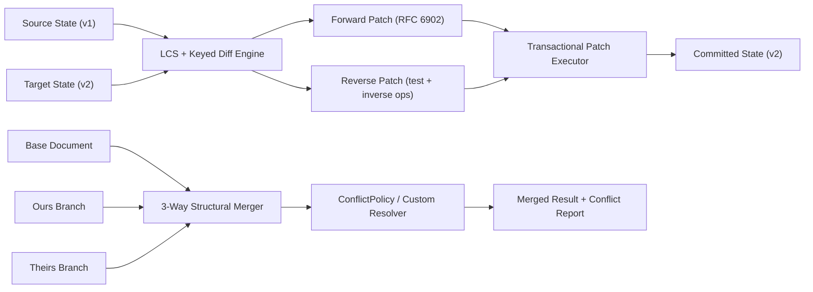

<div align="center">

# ⚡ patchloom

**Zero-dependency RFC 6902 JSON Patch, RFC 7396 Merge Patch, reversible structural diff & three-way merge engine for Python 3.12+.**

[](https://pypi.org/project/patchloom/)
[](https://pypi.org/project/patchloom/)
[](https://opensource.org/licenses/MIT)
[](https://github.com/mrhamidrezam/patchloom/actions/workflows/ci.yml)
[](https://peps.python.org/pep-0561/)
[](#)

</div>

---

## Why `patchloom`?

Event-sourced backends, configuration control planes, optimistic HTTP `PATCH` APIs, audit logs, and collaborative state engines all share the same core primitives: **exact structural diffing**, **transactional patching**, **deterministic undo/rollback**, and **three-way merging**.

Existing Python libraries typically cover only one slice of the problem, rely on naive index-by-index list comparison, conflate Python booleans with integers (`True == 1`), or mutate target documents half-way through a failed patch.

**`patchloom`** unifies all four standards in a compact, strictly typed, **zero-dependency** Python 3.12+ package:

- **RFC 6901 JSON Pointer**: Immutable pointer arithmetic (`Pointer("/users") / 0 / "role"`), URI fragment decoding, strict `~0`/`~1` unescaping, and `*` / `**` glob matching.
- **RFC 6902 JSON Patch**: All 6 operations (`add`, `remove`, `replace`, `move`, `copy`, `test`) with **100% transactional atomicity** (failed patches never leave partial mutations) and strict JSON type equality (`True != 1`, `False != 0`).
- **LCS & Keyed Structural Diff**: Longest Common Subsequence array alignment, identity-keyed record diffing (`array_keys="id"`), automatic `move` & `copy` compression, wildcard path exclusions, float epsilon tolerance, and `dataclass` / `Enum` normalization.
- **Reversible Deltas (`ReversiblePatch`)**: Generates paired forward and inverse RFC 6902 patches guarded by `test` preconditions for safe state rollback and optimistic concurrency checks.
- **RFC 7396 JSON Merge Patch**: Minimal merge-patch generation and spec-compliant application.
- **Three-Way Structural Merge (`merge3`)**: Merges concurrent changes (`base`, `ours`, `theirs`) across nested objects and keyed arrays with fine-grained conflict classification and pluggable resolution policies.

---

## Architecture



---

## Installation

```bash
pip install patchloom
```

*Requires Python 3.12 or newer. Zero third-party runtime dependencies.*

---

## Quick Start

### 1. Structural Diff & Atomic RFC 6902 Patching

`diff()` computes minimal patches using Longest Common Subsequence (LCS) alignment on arrays and automatically coalesces renamed keys into `move` operations:

```python
from patchloom import apply_patch, diff

before = {
    "service": "billing-api",
    "legacy_timeout": 30,
    "regions": ["eu-central-1", "us-east-1"],
}
after = {
    "service": "billing-api",
    "request_timeout": 30,
    "regions": ["eu-central-1", "ap-south-1", "us-east-1"],
}

patch = diff(before, after)
print(patch.to_json(indent=2))
# [
#   { "op": "move", "path": "/request_timeout", "from": "/legacy_timeout" },
#   { "op": "add", "path": "/regions/1", "value": "ap-south-1" }
# ]

assert apply_patch(before, patch) == after
```

### 2. Reversible Patches & Optimistic Concurrency Rollback

`diff_reversible()` emits both `forward` and `reverse` RFC 6902 patches. When `include_tests=True` (the default), rollback operations assert current field values via RFC 6902 `test` guards before reverting—preventing silent data loss if another writer modified the state in between:

```python
from patchloom import PatchTestFailedError, diff_reversible

v1 = {"plan": "starter", "seats": 5, "features": ["export"]}
v2 = {"plan": "enterprise", "seats": 25, "features": ["export", "sso"]}

delta = diff_reversible(v1, v2)

current = delta.apply(v1)
assert current == v2

restored = delta.rollback(current)
assert restored == v1

# Concurrent modification is caught atomically before any rollback mutation occurs:
tampered = {**current, "seats": 99}
try:
    delta.rollback(tampered)
except PatchTestFailedError as err:
    print(err)  # Test failed at '/seats': expected 25, got 99.
```

### 3. Keyed Array Diffing & Wildcard Ignore Patterns

Align collections of domain entities by primary key (`array_keys`) while ignoring volatile metadata like timestamps or secrets (`*` and `**` globs):

```python
from patchloom import diff

prev = {
    "updated_at": "2026-11-17T08:00:00Z",
    "workers": [
        {"id": "w-1", "concurrency": 4, "heartbeat": 101},
        {"id": "w-2", "concurrency": 8, "heartbeat": 102},
    ],
}
curr = {
    "updated_at": "2026-11-18T10:00:00Z",
    "workers": [
        {"id": "w-0", "concurrency": 2, "heartbeat": 200},
        {"id": "w-1", "concurrency": 16, "heartbeat": 201},
        {"id": "w-2", "concurrency": 8, "heartbeat": 202},
    ],
}

patch = diff(
    prev,
    curr,
    array_keys={"/workers": "id"},
    ignore=["/updated_at", "/workers/*/heartbeat"],
)

print(patch.to_list())
# [
#   {'op': 'add', 'path': '/workers/0', 'value': {'id': 'w-0', 'concurrency': 2, 'heartbeat': 200}},
#   {'op': 'replace', 'path': '/workers/1/concurrency', 'value': 16}
# ]
```

### 4. Three-Way Structural Merge (`merge3`)

Merge concurrent edits relative to a common ancestor with built-in policies (`RAISE`, `OURS`, `THEIRS`, `BASE`) or a custom conflict resolver function:

```python
from patchloom import ConflictPolicy, MergeConflict, merge3

base = {"replicas": 2, "limits": {"cpu": "500m", "mem": "512Mi"}}
ours = {"replicas": 4, "limits": {"cpu": "1000m", "mem": "512Mi"}}
theirs = {"replicas": 6, "limits": {"cpu": "500m", "mem": "1Gi"}}

# Custom resolver: pick the higher replica count on conflict
def resolve_higher_replicas(conflict: MergeConflict):
    if str(conflict.path) == "/replicas":
        return max(conflict.ours, conflict.theirs)
    return conflict.ours

result = merge3(base, ours, theirs, policy=resolve_higher_replicas)
assert result.value == {"replicas": 6, "limits": {"cpu": "1000m", "mem": "1Gi"}}
assert len(result.conflicts) == 1
```

### 5. RFC 7396 JSON Merge Patch & RFC 6901 JSON Pointer

```python
from patchloom import Pointer, apply_merge_patch, create_merge_patch

doc = {"title": "v1", "author": {"name": "Hamidreza", "temp": True}}
target = {"title": "v2", "author": {"name": "Hamidreza"}}

mp = create_merge_patch(doc, target)
# {'author': {'temp': None}, 'title': 'v2'}
assert apply_merge_patch(doc, mp) == target

ptr = Pointer.root() / "author" / "name"
assert ptr.resolve(doc) == "Hamidreza"
```

---

## Command-Line Interface

`patchloom` ships with a built-in CLI for shell pipelines, CI checks, and Gitops workflows:

```bash
# Generate an RFC 6902 JSON Patch
patchloom diff old.json new.json --array-key id --ignore "**/updated_at" > changes.patch.json

# Generate paired forward + reverse patches
patchloom diff --reversible old.json new.json > delta.json

# Apply a patch atomically (exits non-zero if any 'test' precondition fails)
patchloom apply old.json changes.patch.json > applied.json

# Three-way merge with conflict policy
patchloom merge3 base.json ours.json theirs.json --policy ours --array-key id

# Extract a value via RFC 6901 JSON Pointer
patchloom get config.json "/database/pool/max_connections"
```

---

## Standards Implemented

| Specification | Scope | Module |
| :--- | :--- | :--- |
| **RFC 6901** | JavaScript Object Notation (JSON) Pointer | `patchloom.pointer` |
| **RFC 6902** | JavaScript Object Notation (JSON) Patch | `patchloom.patch` / `patchloom.diff` |
| **RFC 7396** | JSON Merge Patch | `patchloom.merge_patch` |
| **3-Way Merge** | Recursive Object & Keyed-Collection Structural Merge | `patchloom.merge3` |

---

## Development & Testing

```bash
git clone https://github.com/mrhamidrezam/patchloom.git
cd patchloom
pytest
```

## License

Released under the [MIT License](LICENSE).
